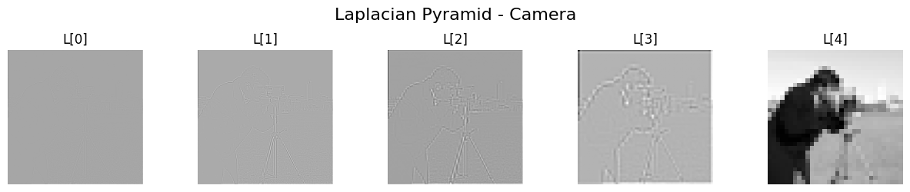

# Laplacian Pyramid Image Coding

A Python implementation of the Laplacian pyramid from Burt and Adelson's 1983 paper, *The Laplacian Pyramid as a Compact Image Code*. The notebook builds Gaussian and Laplacian pyramids from scratch with NumPy and OpenCV, decodes them back into the original image, and studies how the kernel parameter `a`, the pyramid depth and the quantization bin sizes affect reconstruction, entropy and image quality. It works on both grayscale and colour images.

This is my solution to the first individual assignment of **Image and Video Analysis and Technology** (Τεχνολογία και Ανάλυση Εικόνων και Βίντεο), an 8th-semester course at the School of Electrical and Computer Engineering, National Technical University of Athens (ECE NTUA), academic year 2024–25.



The whole assignment is in one notebook, [`IVAT25_labproject1_03121087_NasopoulouEleni.ipynb`](IVAT25_labproject1_03121087_NasopoulouEleni.ipynb). Its text and comments on the results are in Greek; the code and its comments are in English.

| Part | Content |
|------|---------|
| [Theory](#theory) | Short answers on the paper: the effect of `a`, entropy, bin size and number of levels |
| [A. Implementation](#a-implementation) | Kernel, reduce, expand, Gaussian and Laplacian pyramids, decoding, quantization |
| [B. Experiments](#b-experiments) | Reconstruction, varying `a` and depth, entropy per level, best `a`, quantization |

## Getting started

### Prerequisites

- Python 3 (tested with 3.12)
- The libraries in [`requirements.txt`](requirements.txt): NumPy, OpenCV, SciPy, scikit-image and Matplotlib
- Internet access: the Lena test image is downloaded from an NTUA server (`image.ntua.gr`)

The notebook was written in Google Colab, where all of these libraries are already installed.

### Run

```bash
git clone https://github.com/eleninspl/laplacian-pyramid-image-coding.git
cd laplacian-pyramid-image-coding
python3 -m venv .venv
source .venv/bin/activate
pip install -r requirements.txt jupyter
jupyter notebook IVAT25_labproject1_03121087_NasopoulouEleni.ipynb
```

Then run all cells in order. The full notebook runs in well under a minute on a laptop. The camera image comes with scikit-image.

## Theory

The assignment starts with four short questions on the paper. The notebook answers them in Greek:

- **The parameter `a`**: it sets the shape of the equivalent weighting function. Around 0.4 it is close to a Gaussian, at 0.5 it is triangular, at 0.3 it is flatter and broader, and at 0.6 it has a sharper peak with small negative side lobes. The paper found the largest entropy reduction at `a = 0.6`.
- **Entropy**: the average number of bits per pixel needed to code the image if pixels are independent. For an 8-bit grayscale image the maximum is 8 bits per pixel, reached when all 256 grey levels are equally likely.
- **Bin size**: larger bins give more compression and more distortion; smaller bins keep quality but need more bits.
- **Pyramid levels**: the eye is less sensitive to errors at high spatial frequencies, so the low pyramid levels can be quantized more coarsely than the high ones.

## A. Implementation

**Task.** Implement the following functions, following the equations in the paper:

| Function | What it does |
|----------|--------------|
| `GKernel(a)` | 5×5 generating kernel. The 1-D weights are `[1/4 − a/2, 1/4, a, 1/4, 1/4 − a/2]`, and the 2-D kernel is their outer product. |
| `GREDUCE(I, h)` | Filter with `h` and keep every second row and column (equation 1 of the paper). |
| `GPyramid(I, a, depth)` | Gaussian pyramid: the original image followed by `depth − 1` reduced levels. |
| `GEXPAND(I, h)` | Insert zeros between samples, then filter with `4h` to double the size (equation 2). |
| `L_Pyramid(I, a, depth)` | Laplacian pyramid: `L_i = G_i − EXPAND(G_{i+1})`, with the top Gaussian level stored as the last level. |
| `L_Pyramid_Decode(L, a)` | Rebuild the image from the top down: `R_i = EXPAND(R_{i+1}) + L_i`. |
| `L_Quantization(L, bin_sizes)` | Uniform quantization of each level, `Q_i = n_i · round(L_i / n_i)` (equation 5). Takes one bin size for all levels or a list with one per level. |

**How it works.** Filtering uses `cv2.filter2D` with reflected borders. The image functions accept a 2-D grayscale or 3-D colour array; colour images are processed one channel at a time. All levels are kept as `float32`, so the Laplacian levels keep their negative values and decoding needs no rounding until the end.

## B. Experiments

The tests use two 512×512 images: the colour Lena image and scikit-image's grayscale camera image. All numbers below are from the outputs saved in the notebook unless stated otherwise.

### 1. Encode and decode

**Task.** Check that `L_Pyramid` and `L_Pyramid_Decode` work on colour and grayscale images.

**Result.** With `a = 0.6` and depth 5, both images are reconstructed with a maximum difference of 1 grey level and an MSE of 0.0046 (Lena) and 0.0100 (camera). These small differences come from converting the floating-point result to 8-bit integers, not from the pyramid itself (see [Known limitations](#known-limitations)).

### 2 and 3. Varying `a` and depth

**Task.** Show the original and decoded image for `a` from 0.3 to 0.7 and for depth from 3 to 6.

**Result.** The notebook shows every pyramid and every reconstruction. All reconstructions are visually identical to the original, and the error stays at a maximum of 1 grey level in every case.

### 4 and 5. Entropy per level and the best `a`

**Task.** Compute the entropy of each Laplacian level for different `a` and depth values, plot it, and find the `a` with the lowest entropy at each level.

**How it works.** The entropy of each level is computed from its histogram; for Lena it is the mean over the three channels. A helper prints a table with the entropy of every level for every `a` and picks the minimum.

| Level | 0 | 1 | 2 | 3 | 4 (top, low-pass) |
|-------|---|---|---|---|---|
| Best `a`, Lena | 0.6 | 0.5 | 0.5 | 0.5 | 0.3 |
| Best `a`, camera | 0.6 | 0.5 | 0.5 | 0.5 | 0.5 |

The band-pass levels have much lower entropy than the top level, which still holds a small copy of the whole image. Changing the depth leaves the lower levels unchanged and only adds or removes levels at the top. Overall, `a = 0.5` gives the lowest entropy at most levels, and that value is used for quantization.

### 6. Quantization

**Task.** With the best `a`, quantize both images with two different sets of bin sizes and compare the results.

**How it works.** Both experiments use `a = 0.5` and depth 5. Experiment 1 uses bins `[30, 20, 15, 10, 5]` from level 0 to level 4, so the fine detail levels are quantized coarsely and the low-frequency levels finely, as the paper suggests. Experiment 2 reverses the order.

**Result.** The saved notebook does not include the output of these two cells. Running them again gives:

| Image | Bins (level 0 → 4) | Max difference | Mean abs. difference | MSE |
|-------|--------------------|----------------|----------------------|-----|
| Lena | `[30, 20, 15, 10, 5]` | 63 | 5.37 | 48.8 |
| Lena | `[5, 10, 15, 20, 30]` | 118 | 6.67 | 72.1 |
| Camera | `[30, 20, 15, 10, 5]` | 52 | 4.81 | 47.1 |
| Camera | `[5, 10, 15, 20, 30]` | 76 | 6.17 | 64.6 |

Coarse bins at the high-frequency levels give a clearly smaller error than coarse bins at the low-frequency levels, which matches the paper's argument.

## Known limitations

The notebook is kept as it was submitted. While writing this README, I reviewed it again and found the issues below:

- **Entropy of the Laplacian levels is underestimated.** `compute_entropy` clips values to 0–255 and converts them to `uint8`, so every negative value, about half of each band-pass level, ends up in the same bin. Computed on the rounded values without clipping, the entropy of the band-pass levels is roughly twice as high (for example 4.28 instead of 1.98 bits for level 0 of the camera image with `a = 0.5`). The best `a` per level comes out the same, except for the camera's top level, where 0.5 and 0.6 differ by about 0.001 bits.
- **The reconstruction errors are a rounding artefact.** `compare_to_original` and the error helpers convert the result to `uint8` by truncation. A value such as 99.99998 becomes 99, which produces the "max difference 1" results. Rounding first gives a difference of 0 for every `a` and depth tested; in floating point the reconstruction is exact to within about 0.001. So the notebook's comments that some values of `a` or depth reconstruct more accurately than others are not supported by the data.
- **Image sizes must be divisible by 2^(depth − 1).** For other sizes, `GEXPAND` returns an image one pixel larger than the level below, and `L_Pyramid` stops with a `ValueError`. Both test images are 512×512, so the experiments are not affected.
- `L_Quantization` treats a tuple or NumPy array of bin sizes as a single value. Pass a list.
- In the theory answer on entropy, the formula is written with `log2(i)` instead of `log2 f(i)`, and the text says "lossy" where it should say lossless coding.

## Reference

P. J. Burt and E. H. Adelson, "The Laplacian Pyramid as a Compact Image Code," *IEEE Transactions on Communications*, vol. 31, no. 4, pp. 532–540, April 1983. [PDF](https://persci.mit.edu/pub_pdfs/pyramid83.pdf)

## For students taking the course

This repository is here to help you understand the material: how the pyramid functions fit together and what results to expect. Write your own solution. The assignment is individual and is followed by an individual examination, and code you did not write will not get you through it.

The best reference is the paper itself. Equations 1, 2 and 5 map directly onto `GREDUCE`, `GEXPAND` and `L_Quantization`.
